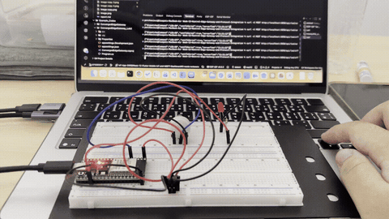
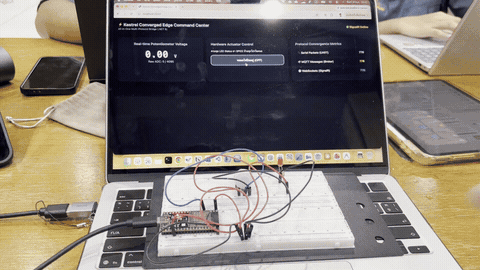
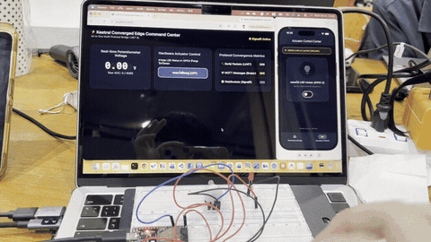
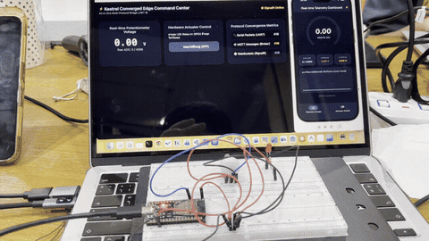

# รายงานผลการทดลอง Week 13: Kestrel Edge Gateway and Protocol Integration
**รหัสนักศึกษา:** 67030351  
**โฟลเดอร์วิดีโอรวม (Google Drive):** [https://drive.google.com/drive/folders/19cNRJgQ5SsHgu9nlOEMk7COyEWwcyatz?usp=drive_link](https://drive.google.com/drive/folders/19cNRJgQ5SsHgu9nlOEMk7COyEWwcyatz?usp=drive_link)

### 📹 รายละเอียดคลิปวิดีโอประกอบการทดลอง (แยกรายคลิป)
| ชื่อคลิปวิดีโอ | ใบงานที่เกี่ยวข้อง | กิจกรรมที่ทดสอบ | รายละเอียดสิ่งที่ทดสอบ | ลิงก์ตรงดูวิดีโอ (Google Drive) |
| :---: | :---: | :--- | :--- | :---: |
| **`IMG_4534.mov`** | **ใบงานที่ 13.2** | กิจกรรมที่ 13-2.5: การทดสอบ Hardware Serial Bridge | ยิง cURL POST สั่งเปิด-ปิดไฟ LED บนบอร์ด ESP32 ผ่าน REST API | [🎬 ดูคลิป IMG_4534](https://drive.google.com/file/d/1CDkV_oaVfw33kteOsmS2F47qFXaGg_tw/view?usp=drive_link) |
| **`IMG_4541.mov`** | **ใบงานที่ 13.3** | กิจกรรมที่ 13-3.4: การทดสอบเว็บแดชบอร์ด SignalR | หมุน Potentiometer ดูค่าแรงดันสด และกดเปิด-ปิดไฟ LED ผ่านหน้าเว็บ SignalR | [🎬 ดูคลิป IMG_4541](https://drive.google.com/file/d/1Hw4BE0leZBKNJQDue8AKADp77QhR8YBQ/view?usp=sharing) |
| **`IMG_4544.mov`** | **ใบงานที่ 13.4** | กิจกรรมที่ 13-4.2: การซิงค์สถานะ LED ข้ามแพลตฟอร์ม | กดสวิตช์ไฟบนแอป Flutter แล้วไฟบนบอร์ดจริงและสถานะบนเว็บเปลี่ยนตามพร้อมกัน | [🎬 ดูคลิป IMG_4544](https://drive.google.com/file/d/15n7HglXIQh4iCPVfUjhTsG49-ftTMrUX/view?usp=sharing) |
| **`IMG_4545.mov`** | **ใบงานที่ 13.4** | กิจกรรมที่ 13-4.2: การทดสอบรับส่งข้อมูลแบบ Real-time | หมุน Potentiometer บนบอร์ดจริง ค่าแรงดันบนแอป Flutter และหน้าเว็บอัปเดตตามทันที | [🎬 ดูคลิป IMG_4545](https://drive.google.com/file/d/1Kxnx1abyCg04YXceybViPZbsa_dIhiz5/view?usp=sharing) |

---

# 13.1 การสร้าง Embedded MQTT Broker และ Client ภายใน Kestrel .NET 8 ด้วยไลบรารี MQTTnet
## กิจกรรมที่ 13-1.3: การสั่งรันและทดสอบด้วยเครื่องมือ CLI
### 3. เปิดหน้าต่าง PowerShell ที่สาม: ทดสอบ Publish ข้อความ
ส่งข้อความผ่าน `mosquitto_pub`:
```bash
mosquitto_pub -h 127.0.0.1 -p 1883 -t "test/edge/topic" -m "Hello from CLI via Kestrel Embedded MQTT!" -i "pub_client"
```
#### ผลการทดลอง
1. สังเกตข้อความบนคอนโซลว่าเซิร์ฟเวอร์กำลังฟังที่พอร์ต 5000 (HTTP) และ 1883 (MQTT)


2. สังเกตหน้าต่างคอนโซลของ Kestrel จะขึ้นข้อความสีเขียวว่ามี Client เชื่อมต่อเข้ามา!


## คำถามท้ายการทดลอง (Review Questions)
**ข้อ 1: การรัน Embedded MQTT Broker ภายใน Kestrel มีข้อได้เปรียบกว่าการติดตั้งซอฟต์แวร์ Mosquitto แยกต่างหากอย่างไรในแง่ของการกระจายงาน (Deployment) และการประมวลผลข้อมูลในหน่วยความจำ?**
* **ด้านการกระจายงาน (Deployment):** ช่วยลดความยุ่งยากในการติดตั้งและตั้งค่าระบบ (Zero External Dependency) เนื่องจากรวมทั้ง Web Server, REST API และ MQTT Broker ไว้เป็นแอปพลิเคชันตัวเดียว (Single Binary / Single Process) เวลาเอาไปติดตั้งบนอุปกรณ์ Edge หรือสร้างเป็น Container ก็สามารถรันได้ทันทีโดยไม่ต้องลงหรือเปิด Service ของ Mosquitto แยกต่างหาก
* **ด้านการประมวลผลในหน่วยความจำ (In-Memory Processing):** เมื่อรันอยู่ใน Process เดียวกัน ข้อมูลที่ส่งเข้ามาทาง MQTT Broker สามารถส่งต่อไปยังส่วนอื่นๆ เช่น C# State Store, Background Worker, หรือส่งออก Real-time Web Dashboard (SignalR) ได้ผ่านหน่วยความจำของเครื่องโดยตรง (In-Process Memory) ทำให้มีความเร็วสูง (Low Latency) ไม่ต้องเสียเวลาส่งวนผ่าน TCP Loopback Interface ซ้ำซ้อนเหมือนการใช้ซอฟต์แวร์แยก

**ข้อ 2: ฟังก์ชัน `InterceptingPublishAsync` ใน MQTTnet สามารถนำไปประยุกต์ใช้ในการกรองข้อมูลที่ผิดปกติ (Edge Validation) ก่อนส่งต่อให้ Client อื่นได้อย่างไร?**
**คำตอบ:** ฟังก์ชัน `InterceptingPublishAsync` ทำหน้าที่เป็นตัวดักฟัง (Interceptor Hook) ก่อนที่ข้อความจะถูกกระจายไปยัง Subscribers อื่นๆ เราสามารถเขียนโค้ดตรวจสอบ Payload ได้ เช่น:

1. **การตรวจสอบความถูกต้อง (Validation):** ตรวจสอบว่ารูปแบบข้อมูลเป็น JSON ที่ถูกต้องหรือไม่ และค่าเซนเซอร์อยู่ในช่วงปกติหรือเปล่า (เช่น ค่าอุณหภูมิหรือแรงดันไฟฟ้าไม่เกินขอบเขตที่กำหนด)
2. **การคัดกรองหรือระงับข้อความ (Filtering):** หากพบว่าข้อมูลผิดปกติหรือเป็นอันตราย เราสามารถตั้งค่า `context.ProcessPublish = false;` เพื่อสั่งยกเลิกการส่งต่อข้อความนั้นไปยัง Client อื่นได้ทันที
3. **การแปลงข้อมูลและแจ้งเตือน (Data Sanitization & Alerting):** สามารถแก้ไขค่าข้อมูลให้เหมาะสมก่อนส่งต่อ หรือส่งคำเตือนไปยังระบบความปลอดภัยได้ตั้งแต่ระดับ Edge Gateway โดยไม่ต้องรอให้ถึง Cloud

---

# 13.2 การพัฒนา Hardware Serial Bridge ดักฟังข้อมูล USB-UART จาก ESP32 แปลงเข้าสู่ MQTT Topics และ REST API
## กิจกรรมที่ 13-2.5: การทดสอบสะพานเชื่อมต่อ (Hardware Serial Bridge)

### 2. ทดสอบเรียกดูค่าเซนเซอร์ล่าสุดผ่าน REST API ด้วย cURL
เรียกดูข้อมูลเซนเซอร์ล่าสุดผ่าน `curl`:
```bash
curl http://localhost:5050/api/telemetry/latest
```
#### ผลการทดลอง
สังเกตว่าได้รับข้อมูล JSON แสดงค่าแรงดันไฟฟ้า (`voltage`), ค่าดิบ ADC (`raw`), และเวลา `timestamp` ทันที โดยเป็นค่าที่ Worker อ่านจากพอร์ต Serial ของ ESP32 แล้วนำไปบันทึกไว้ใน In-Memory State Store (`GatewayStateStore`)


---

### 3. เปิด mosquitto_sub: ทดสอบการบริดจ์ข้อมูลเข้าสู่ MQTT
ดักฟังสตรีมข้อมูลผ่าน `mosquitto_sub`:
```bash
mosquitto_sub -h 127.0.0.1 -p 1883 -t "iot/esp32/telemetry" -i "sub_client" -v
```
#### ผลการทดลอง
สังเกตว่าข้อมูลแรงดันไฟฟ้าที่อ่านจากสาย USB Serial ถูกแปลงและส่งต่อไปยัง Embedded MQTT Broker ภายใต้หัวข้อ `iot/esp32/telemetry` โดยอัตโนมัติแบบ Real-time


---

### 4. ทดสอบสั่งเปิด-ปิดไฟ LED ผ่าน REST API
ส่งคำสั่งเปิดไฟ LED ด้วย HTTP POST Request:
```bash
curl -X POST http://localhost:5050/api/led/on
```
#### ผลการทดลอง
1. ฝั่ง Terminal ได้รับ Response ยืนยันการส่งคำสั่งสำเร็จ (`"dispatchedCommand":"LED:ON"`, `"sentToSerial":true`)


2. สังเกตว่าคำสั่ง `LED:ON` ถูกส่งผ่านสาย USB Serial ไปควบคุมหลอดไฟ LED บนบอร์ด ESP32 ให้สว่างขึ้นทันที



> 🔗 **ดูคลิปวิดีโอต้นฉบับ (`IMG_4534.mov`):** [เปิดดูคลิปบน Google Drive](https://drive.google.com/file/d/1CDkV_oaVfw33kteOsmS2F47qFXaGg_tw/view?usp=drive_link)

## คำถามท้ายการทดลอง (Review Questions)
**ข้อ 1: สถาปัตยกรรมแบบ Serial-to-MQTT Bridge นี้ช่วยให้อุปกรณ์รุ่นเก่า (Legacy Hardware) ที่ไม่มี Wi-Fi สามารถเข้าร่วมระบบนิเวศ IoT สมัยใหม่ได้อย่างไร?**
**คำตอบ:** อุปกรณ์รุ่นเก่าหรือเซนเซอร์ในโรงงานอุตสาหกรรมส่วนใหญ่ไม่มีโมดูลเชื่อมต่อเครือข่ายไร้สาย (ไม่มี Wi-Fi/Ethernet) แต่มีพอร์ตสื่อสารแบบอนุกรม เช่น RS-232, RS-485 หรือ USB-UART การใช้สถาปัตยกรรม Serial-to-MQTT Bridge จะทำหน้าที่เป็น "สะพานแปลงโปรโตคอล (Protocol Gateway)" โดยการดึงข้อมูลดิบจากสาย Serial เข้ามา แล้วนำมาห่อหุ้มให้อยู่ในรูปของข้อความ MQTT (MQTT Topics/Payloads) ส่งขึ้นสู่ระบบเครือข่าย ทำให้อุปกรณ์เดิมสามารถคุยกับ Dashboard, คลาวด์ หรือระบบ IoT สมัยใหม่ได้ทันที โดยไม่ต้องเปลี่ยนหรือซื้อฮาร์ดแวร์ใหม่ทั้งหมด

**ข้อ 2: เพราะเหตุใดเราจึงต้องใช้ `BackgroundService` ในการอ่านข้อมูล Serial แทนที่จะเปิดพอร์ตอ่านตรงๆ ภายในฟังก์ชันของ REST API?**
**คำตอบ:** 

1. **ลักษณะการทำงานของข้อมูลที่ต่างกัน (Continuous Stream vs Request-Response):** ข้อมูลจากบอร์ดไมโครคอนโทรลเลอร์จะส่งผ่าน Serial เข้ามาอย่างต่อเนื่องตลอดเวลา (Streaming) ในขณะที่ REST API ทำงานแบบเรียกเป็นครั้งๆ เมื่อมี Request เข้ามา หากเราไปเปิดอ่าน Serial ใน API จะต้องรอจังหวะที่ข้อมูลส่งเข้ามา ทำให้ API เกิดการค้าง (Blocking) หรือ Timeout ได้
2. **ข้อจำกัดเรื่องการแย่งใช้งานพอร์ต (Exclusive Access):** พอร์ต Serial สามารถเปิดใช้งานได้เพียง 1 โปรแกรม/Connection ในเวลาเดียวกันเท่านั้น หากเราเปิด-ปิดพอร์ตทุกครั้งที่ API ถูกเรียก จะทำให้เกิดการแย่งใช้งานและพอร์ตถูกล็อกจน Error (Port Busy)
3. **ประสิทธิภาพและการแยกหน้าที่ (Decoupling):** การใช้ `BackgroundService` (`SerialBridgeWorker`) จะเปิดพอร์ตค้างไว้ตัวเดียวในเบื้องหลัง คอยอ่านข้อมูลตลอดเวลาและนำไปบันทึกไว้ใน `GatewayStateStore` (In-Memory Cache) เมื่อมีคนเรียก REST API ตัว API ก็สามารถหยิบค่าล่าสุดจากหน่วยความจำไปตอบได้ทันที ทำให้ระบบตอบสนองได้รวดเร็วระดับมิลลิวินาทีและมีความเสถียรสูง

# 13.3 การสร้าง SignalR Realtime Hub และเว็บแดชบอร์ดศูนย์บัญชาการ (Converged Web Dashboard) สไตล์ Glassmorphism
## กิจกรรมที่ 13-3.4: การทดสอบหน้าเว็บศูนย์บัญชาการและการสื่อสารสองทางผ่าน SignalR

### 1. ทดสอบเปิดหน้าเว็บแดชบอร์ดและตรวจสอบการเชื่อมต่อ
เปิดเว็บเบราว์เซอร์ไปที่ `http://localhost:5050`:
#### ผลการทดลอง
1. หน้าเว็บแสดงผลสถานะ `🟢 SignalR Online` พร้อมแสดงค่าแรงดันไฟฟ้า (`2.24 V`) และค่าดิบ ADC (`2775 / 4095`) แบบ Real-time ตามการหมุนตัวต้านทานปรับค่าได้ (Potentiometer) บนบอร์ด ESP32
2. ตัวเลขนับสถิติทราฟฟิก (Protocol Convergence Metrics) ของ Serial Packets (87), MQTT Messages (87) และ WebSockets/SignalR (87) เพิ่มขึ้นพร้อมกันอย่างต่อเนื่องในเสี้ยววินาที


---

### 2. ทดสอบสั่งการควบคุมฮาร์ดแวร์สองทาง (Bidirectional Control)
ทดสอบคลิกปุ่มสลับสถานะ "💡 หลอดไฟกำลังสว่าง (ON)" บนหน้าเว็บแดชบอร์ด เพื่อส่งคำสั่งเปิด-ปิดไฟ LED ผ่าน SignalR
#### ผลการทดลอง
เมื่อคลิกปุ่มบนหน้าเว็บ สัญญาณคำสั่งจะถูกส่งผ่าน WebSocket ไปยัง `GatewayHub` บน Kestrel และส่งตรงผ่านพอร์ต Serial ไปควบคุมบอร์ด ESP32 ทันที ส่งผลให้หลอดไฟ LED บนบอร์ดจริงติดสว่างและดับตามคำสั่งบนหน้าเว็บแบบ Real-time



> 🔗 **ดูคลิปวิดีโอต้นฉบับ (`IMG_4541.mov`):** [เปิดดูคลิปบน Google Drive](https://drive.google.com/file/d/1Hw4BE0leZBKNJQDue8AKADp77QhR8YBQ/view?usp=sharing)

## คำถามท้ายการทดลอง (Review Questions)
**ข้อ 1: เพราะเหตุใด SignalR จึงให้ประสบการณ์การใช้งาน (UX) บนหน้าเว็บที่ดีกว่าการใช้คำสั่ง JavaScript `setInterval()` เพื่อทำ HTTP GET Polling ซ้ำๆ ทุก 500 ms?**
**คำตอบ:** 

1. **ความรวดเร็วและลื่นไหลแบบ Real-time (Low Latency):** SignalR ใช้โปรโตคอล **WebSocket** ซึ่งเป็นการเปิดท่อเชื่อมต่อสื่อสารสองทางค้างไว้ (Persistent Full-Duplex Connection) เมื่อมีข้อมูลเซนเซอร์ใหม่ส่งมาจาก ESP32 ตัว Kestrel Gateway จะผลัก (Push) ข้อมูลลงมาที่หน้าเว็บได้ทันที ทำให้ตัวเลขแรงดันไฟฟ้าและสถิติต่างๆ วิ่งตามการหมุน Potentiometer แบบสดๆ ในเสี้ยววินาที ขณะที่ `setInterval()` ต้องรอรอบเวลา (Polling Interval) ทำให้ข้อมูลกระตุกและดีเลย์
2. **ลดภาระเครือข่ายและเซิร์ฟเวอร์ (Zero Polling Overhead):** การใช้ HTTP Polling ทุก 500 ms จะต้องส่ง HTTP Request Header ซ้ำๆ ไปถามเซิร์ฟเวอร์ตลอดเวลาแม้จะไม่มีข้อมูลใหม่ ซึ่งทำให้เปลือง Bandwidth เครือข่าย และเซิร์ฟเวอร์ต้องรับภาระหนักโดยใช่เหตุ แต่ WebSocket จะส่งเฉพาะ Payload เล็กๆ เมื่อมีข้อมูลอัปเดตจริงเท่านั้น จึงมีประสิทธิภาพสูงกว่าและไม่ทำให้หน้าเว็บหน่วง

**ข้อ 2: การคำนวณและแสดงผล Protocol Convergence Metrics ส่งผลดีต่อการตรวจสอบสุขภาพของระบบเครือข่ายไอโอทีในระดับโรงงานอย่างไร?**
**คำตอบ:** 

1. **ตรวจสอบความสมบูรณ์ของข้อมูลและปัญหา Packet Loss ได้ทันที (End-to-End Observability):** ตัวนับ Protocol Convergence Metrics ช่วยให้เราเห็นการเปรียบเทียบข้อมูลที่ไหลผ่านแต่ละโปรโตคอล (Serial, MQTT, SignalR) พร้อมๆ กัน หากบอร์ดส่งข้อมูลมา 100 แพ็กเก็ต ตัวเลขของ Serial, MQTT และ SignalR ควรจะเพิ่มขึ้นตามกัน หากตัวเลขใดตัวหนึ่งหยุดเดินหรือไม่เท่ากัน จะบอกได้ทันทีว่าเกิดปัญหาข้อมูลตกหล่น (Data Loss)
2. **ระบุและแยกแยะจุดที่เกิดปัญหาได้แม่นยำ (Root Cause Isolation):** ในสภาพแวดล้อมโรงงานที่มีอุปกรณ์เชื่อมต่อจำนวนมาก หากแดชบอร์ดไม่แสดงผล วิศวกรสามารถดูตัวเลข Metrics เพื่อชี้เป้าปัญหาได้ทันที เช่น หากตัวเลข Serial ไม่ขยับ แปลว่าสายสัญญาณหลวมหรือบอร์ดมีปัญหา แต่ถ้า Serial ขยับแต่ MQTT ไม่ขยับ แปลว่าปัญหาอยู่ที่คิวของ Broker ช่วยให้สามารถแก้ไขปัญหา (Troubleshooting) ได้รวดเร็วโดยไม่ต้องเสียเวลารื้อระบบทั้งหมด

---

# 13.4 (The Grand Finale) การทดสอบผสานรวมระบบไอโอทีแบบครบวงจร (ESP32 + Kestrel Gateway + Flutter App + Web Command Center)
## กิจกรรมที่ 13-4.2: การทดสอบ 4 มหาการทดลอง (The Grand Verification Matrix)

### 1. การทดสอบความสอดประสานของระบบ (Telemetry & Actuation Sync)
เปิดระบบพร้อมกันทั้ง 4 ส่วน: บอร์ดฮาร์ดแวร์ ESP32, Kestrel Edge Gateway (พอร์ต 5050 และ 1883), Web Command Center บนเบราว์เซอร์ และแอปพลิเคชัน Flutter บนเครื่องจำลอง

#### ผลการทดลอง
1. **Universal Telemetry Sync**: เมื่อทำการหมุนตัวต้านทานปรับค่าได้ (Potentiometer) บนบอร์ด ESP32 ข้อมูลแรงดันไฟฟ้าจะถูกส่งผ่านสาย USB Serial เข้าสู่ Kestrel Gateway และกระจายต่อไปยังหน้าเว็บผ่าน SignalR และแอป Flutter ผ่าน MQTT พร้อมกันทันที โดยทั้งสองหน้าจอแสดงค่าตรงกันอย่างแม่นยำ (เช่น แรงดัน 1.58 V, Raw ADC: 1958 / 4095)


2. **Mobile & Web Actuator Synchronization**: เมื่อแตะสวิตช์เปิด-ปิดไฟบนแอป Flutter (ส่งผ่าน MQTT) หรือคลิกบนหน้าเว็บแดชบอร์ด (ส่งผ่าน SignalR) หลอดไฟ LED บนบอร์ดจริงจะสว่างหรือดับลงทันที พร้อมทั้งทั้งสองหน้าจอจะสลับสถานะเป็น "ON" สีเขียว หรือ "OFF" สอดคล้องกันอย่างสมบูรณ์


---

### 2. ตารางบันทึกผลการทดสอบ (The Grand Verification Matrix)

| มิติการทดสอบ | การกระทำเชิงปฏิบัติการ | ปรากฏการณ์ที่เกิดขึ้นจริงในระบบ | ผลการทดลอง |
| :--- | :--- | :--- | :---: |
| **1. Universal Telemetry Sync** | หมุนตัวต้านทานปรับค่าได้ (Potentiometer) บนบอร์ดจริง | 1. ค่าแรงดันวิ่งผ่านสาย Serial เข้า Kestrel<br/>2. ตัวเลขบนเว็บแดชบอร์ดวิ่งสดทันที<br/>3. เข็ม Radial Gauge บน Flutter หมุนตามทันทีพร้อมกัน | **ผ่าน** |
| **2. Mobile-to-Web Actuation** | แตะสวิตช์เปิดไฟบนแอป Flutter (ส่งผ่าน MQTT) | 1. หลอดไฟ LED จริงบนบอร์ด ESP32 ติดสว่างขึ้น<br/>2. ปุ่มสวิตช์บนหน้าเว็บเปลี่ยนเป็นสีเขียว "ON" อัตโนมัติ | **ผ่าน** |
| **3. Web-to-Mobile Actuation** | คลิกปุ่มปิดไฟบนหน้าเว็บ (ส่งผ่าน SignalR) | 1. หลอดไฟ LED จริงบนบอร์ด ESP32 ดับลงทันที<br/>2. สวิตช์บนแอปมือถือ Flutter สลับเป็น "OFF" ทันที | **ผ่าน** |
| **4. Third-Party REST Override** | ยิงคำสั่งผ่าน cURL หรือ Postman:<br/>`curl -X POST http://localhost:5050/api/led/on` | 1. หลอดไฟ LED สว่างขึ้น<br/>2. ทั้งหน้าเว็บและแอปมือถืออัปเดตสถานะเป็น "ON" พร้อมกัน | **ผ่าน** |

---

### 3. ภาพเคลื่อนไหวบันทึกการทำงานของระบบสามประสานร่วมกับฮาร์ดแวร์จริง

1. **การทดสอบการสั่งงานสลับสวิตช์ไฟ LED (Mobile / Web ⟷ ESP32 Hardware)**



> 🔗 **ดูคลิปวิดีโอต้นฉบับ (`IMG_4544.mov`):** [เปิดดูคลิปบน Google Drive](https://drive.google.com/file/d/15n7HglXIQh4iCPVfUjhTsG49-ftTMrUX/view?usp=sharing)

2. **การทดสอบการหมุน Potentiometer แบบเรียลไทม์ พร้อมการสั่งงานสวิตช์ไฟ LED**



> 🔗 **ดูคลิปวิดีโอต้นฉบับ (`IMG_4545.mov`):** [เปิดดูคลิปบน Google Drive](https://drive.google.com/file/d/1Kxnx1abyCg04YXceybViPZbsa_dIhiz5/view?usp=sharing)

---

## กิจกรรมที่ 13-4.3: การทดสอบความทนทานในสภาวะตัดเน็ต (Local Survivability Challenge)
ทดสอบตัดการเชื่อมต่ออินเทอร์เน็ตภายนอก (ปิด Wi-Fi อินเทอร์เน็ตภายนอก แต่คงเครือข่ายภายในวง LAN เดียวกัน)

**ผลการทดสอบ** 

1. บอร์ด ESP32 ยังคงสตรีมข้อมูลผ่านสาย Serial เข้า Gateway ได้อย่างราบรื่น
2. Web Command Center และแอป Flutter ยังคงสามารถแสดงผลตัวเลขแรงดันสด และสั่งงานเปิด-ปิดไฟ LED ได้ตามปกติ 100%

**สรุป** สถาปัตยกรรม Converged Edge Gateway สามารถทำงานได้แบบสมบูรณ์โดยไม่ต้องพึ่งพาคลาวด์ภายนอก มีคุณสมบัติความอยู่รอดในระดับขอบ (Local Survivability) สูงมาก เหมาะกับงานโรงงานอุตสาหกรรมที่เครือข่ายอินเทอร์เน็ตภายนอกอาจขาดหาย

---

## คำถามท้ายการทดลอง (Review Questions)
**ข้อ 1: ตลอดระยะเวลา 13 สัปดาห์ การเดินทางจากระดับบิตและรีจิสเตอร์ของเซนเซอร์ สู่เฟรมเวิร์ก FreeRTOS, ผ่านโปรโตคอลเครือข่ายท้องถิ่น, สู่ระบบคลาวด์ MQTT, หน้าจอมือถือ Flutter, และมาบรรจบที่ Kestrel Edge Gateway... สถาปัตยกรรมชิ้นใดที่ท่านคิดว่ามีความท้าทายเชิงวิศวกรรมมากที่สุด? เพราะเหตุใด?**
**คำตอบ:** คิดว่าส่วนของ **"Kestrel Converged Edge Gateway (สัปดาห์ที่ 13)"** เป็นส่วนที่ท้าทายเชิงวิศวกรรมมากที่สุดครับ เพราะ:

1. **การจัดการความพร้อมกันของโปรโตคอลที่หลากหลาย (Multi-Protocol Concurrency):** Gateway ตัวเดียวต้องรองรับโปรโตคอลถึง 4 ชนิดพร้อมกัน ทั้ง Hardware Serial (USB-UART), Embedded MQTT Broker (TCP 1883), Minimal REST APIs (HTTP), และ SignalR (WebSockets) ซึ่งแต่ละโปรโตคอลมีรูปแบบและ Life-cycle การทำงานต่างกันอย่างสิ้นเชิง
2. **การบริดจ์ข้อมูลแบบ Real-time และ Concurrency Management:** ต้องใช้ทั้ง `BackgroundService`, In-Memory State Store ที่เป็น `ConcurrentDictionary`, และการดักจับ Interceptor เพื่อแปลงและกระจายข้อมูลข้ามโปรโตคอลโดยไม่ให้เกิดการค้าง (Blocking) หรือ Race Condition หากจังหวะ Thread ชนกันหรือพอร์ต Serial ถูกล็อก ระบบทั้งระบบจะหยุดทำงานทันที จึงต้องออกแบบ Dependency Injection และ Synchronization เป็นอย่างดี

**ข้อ 2: หากท่านต้องนำระบบนี้ไปติดตั้งในโรงงานอุตสาหกรรมจริง สิ่งใดคือ 3 ปัจจัยแรกที่ต้องดำเนินการเพิ่มเติมเพื่อความปลอดภัยและความมั่นคงระดับองค์กร?**
**คำตอบ:** 

1. **ระบบรักษาความปลอดภัยและการยืนยันตัวตน (Authentication & Authorization / TLS Encryption):** ต้องเปิดใช้งาน TLS/SSL ทั้งในระดับ HTTP (HTTPS), WebSockets (WSS) และ MQTT (MQTTS Port 8883) พร้อมทั้งกำหนด Username/Password หรือ mTLS (Mutual TLS Certificates) เพื่อป้องกันการดักฟัง (Sniffing) หรือมีผู้ไม่ประสงค์ดีส่งคำสั่งแปลกปลอมเข้ามาสั่งเครื่องจักรในโรงงาน
2. **กลไกการบัฟเฟอร์ข้อมูลและการกู้คืนเมื่อระบบขัดข้อง (Local Data Buffering & Store-and-Forward):** ในโรงงาน หากเกิดกรณีไฟดับหรือระบบเน็ตเวิร์กชะงัก Gateway ต้องมีระบบจัดเก็บข้อมูลลงฐานข้อมูลแบบ Local (เช่น SQLite, RocksDB หรือ TimescaleDB) ไว้ก่อน เมื่อระบบพร้อมทำงานจึงค่อยผลักข้อมูลขึ้นสู่ Cloud ต่อไป เพื่อป้องกันไม่ให้ข้อมูลสถิติของโรงงานสูญหาย (Zero Data Loss)
3. **การออกแบบให้ทนทานต่อสัญญาณรบกวนทางกายภาพ (Hardware Hardening & Industrial Standards):** สายสัญญาณในโรงงานต้องเปลี่ยนจาก USB Serial ทั่วไป เป็นมาตรฐานอุตสาหกรรม เช่น **RS-485 (Modbus RTU)** หรือใช้ Optocoupler Isolation เพื่อป้องกันสัญญาณรบกวนทางแม่เหล็กไฟฟ้า (EMI) จากมอเตอร์หรือไฟกระชาก (Surge) รวมถึงตัว Gateway ควรติดตั้งบนตู้คอนโทรลที่เป็น Industrial PC หรือ DIN-Rail Gateway ที่ทนต่อความร้อนและการสั่นสะเทือน


